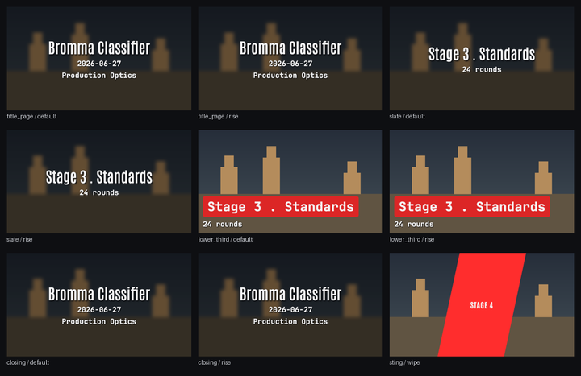
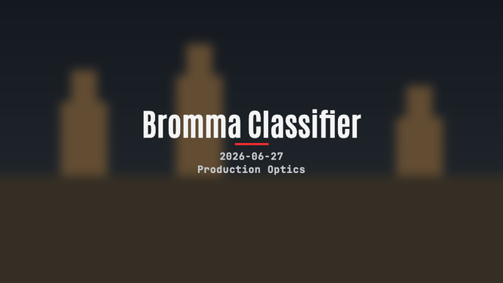
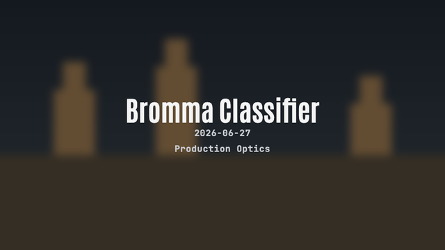
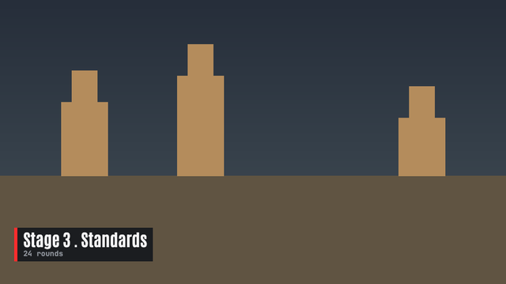
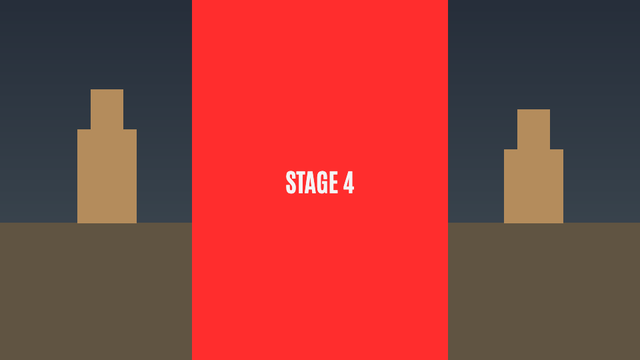

# Making a Look

A Look decides how a rendered video's generated cards look: the title page,
the stage slates, the lower third, the closing card and the stings between
stages, and the overlay styles that draw the live clock, count and splits. It is a folder with a `look.json` (colours and which template draws
which card) and HTML templates. This guide takes you from a copy of the
default Look to your own templates.



## Contents

- [Make one](#make-one)
- [look.json](#lookjson)
- [Templates](#templates)
- [Animation](#animation)
- [Lower third](#lower-third)
- [Stings](#stings)
- [Overlay styles](#overlay-styles)
- [Summaries](#summaries)
- [Logos and identity](#logos-and-identity)
- [Your brand](#your-brand)
- [What a template can load](#what-a-template-can-load)
- [Fonts](#fonts)
- [Checking](#checking)
- [Previewing](#previewing)
- [Sound](#sound)
- [Colour grade](#colour-grade)
- [Credits](#credits)
- [On splitsmith.app](#on-splitsmithapp)

## Make one

```sh
splitsmith looks new club-red --from splitsmith   # a shipped Look's colours, fonts and styles
splitsmith looks new club-red --from splitsmith --templates   # ...and its templates, to edit by hand
splitsmith looks new club-red --starter still     # or a minimal Look around one starter
splitsmith looks check club-red                   # validate it
splitsmith looks preview club-red                 # render every card to PNGs
splitsmith looks list                             # what is installed
```

Your Looks live in `~/.splitsmith/looks/<name>/`. A folder there with the
same name as a shipped Look replaces it.

A copy of a shipped Look names no templates of its own, so every card it
draws is the current shipped template and a new release reaches it. Copy
them with `--templates` only when you mean to edit them; a copy you never
edit freezes the cards at the day you made it. `splitsmith looks check`
warns about such a copy once the shipped template has moved on, and
`splitsmith looks refresh <name>` removes every unedited copy (an edited
file is never touched). A copy of a Broadcast template is brought up to
date in place instead, since removing it would draw the default Look's
template. A copy of your own Look carries every file. Every
copy carries the source's [sound](#sound) (its `sounds` block and the files
in its `sounds/` folder) and its [grade](#colour-grade)'s LUT file, even a
copy that follows the shipped templates, since these are files the Look
names, not code that goes stale.
Pick a Look on the Export page, or
with `--theme <name>` on `match export` and `--overlay-theme <name>` on
`compare export`.

Eight starters ship. Seven are each a short commented template for one slot:

| Starter | What it is |
|---|---|
| `still` | A still card for the title page, slates and closing card |
| `animated` | The same card, its lines rising into place |
| `lower-third` | A band over the first seconds of a stage |
| `sting` | A band swept across the cut between stages |
| `sting-frames` | A frames sting: a push that moves both stages' footage (see [Frames stings](#frames-stings)) |
| `hud` | An overlay style: the clock, the count and the last split in a corner |
| `summary` | A stage summary: the stage's name and its time, hit factor, draw and average split |

The eighth, `broadcast`, is a whole Look and the reference for the data. It
fills every slot a template can draw:

- **Cards:** one animated card for the title page, slates, lower third and
  closing card, with an `end-screen` closing style.
- **Overlay style** (`broadcast`): its Now cell names the region underway,
  draw, movement, reload or activation, on or off the move.
- **Stage summary** (`results`), with a legend of the stage's regions.
- **Match summary** (`table`).
- **YouTube thumbnail.**
- **Sting** (`push`).
- **Sound**: a theme under the title page and closing card, whooshes on the
  cards, a sting timed to the push, and a summary that ticks as it counts
  up and lands on an impact. The starter brings the sound files and the
  `sounds` block with it (see [Sound](#sound)).

Between them they read every field a template can be given, each commented
where it is read. Start there to see what a field holds, then delete what your
Look does not need. The same templates ship as the **Broadcast** Look, so the
Export page shows all of it before you copy anything.

## look.json

```json
{
  "name": "club-red",
  "label": "Club red",
  "colors": { "ink": [244, 244, 245], "accent": [255, 45, 45], "...": "..." },
  "accent_series": ["#ff2d2d", "#fbbf24", "#4ade80"],
  "slots": {
    "title_page": { "default": "card.html", "rise": "card-rise.html" },
    "slate": "card.html",
    "transition": { "wipe": "sting-wipe.html" }
  }
}
```

- `name` matches the folder: lower-case letters, digits, `-` and `_`.
- `colors` are RGB triples. Every one of these is required:

  | Token | Where it shows |
  |---|---|
  | `ink` | Names, figures, the main card text |
  | `ink_2` | Secondary lines: the date, the division |
  | `muted` | Labels such as SCORING and SPLITS |
  | `subtle` | Faint helper text |
  | `surface` | The card backdrop when there is no frame |
  | `rule` | Hairlines between bands |
  | `stroke` | The outline behind text on footage |
  | `accent` | The brand colour: rules, the sting band |
  | `accent_fill` | Filled badges (DQ) |
  | `accent_text` | Text on an accent fill |
  | `split` | The current split |
  | `split_good` | A fast split, Alphas |

  These are optional and default when left out:

  | Token | Default | Where it shows |
  |---|---|---|
  | `reload` | `#FBBF24` | The reload chip and reload bands on an overlay's stage bar |
  | `movement` | `#06B6D4` | Movement bands on an overlay's stage bar |
  | `draw` | `#F472B6` | Draw bands on an overlay's stage bar |

  A template reads them as `#rrggbb` strings. Keep `reload`, `movement` and
  `draw` apart from `accent`: red is the brand and the slow split, not an event.
- `accent_series` colours shooters who have not set an accent of their own,
  by grid tile.
- `slots` names a template per card: `title_page`, `slate`, `lower_third`,
  `closing`, and `transition` for stings. A bare file name is the `default`
  style; a map names several styles, which become the Style choices on the
  Export page. A card your Look does not name is drawn by the shipped
  `splitsmith` Look's template in your colours.

## Templates

A template is an HTML page rendered in Chromium at the video's frame size.
It is drawn over the stage's blurred frame, so keep the page transparent.
Before your scripts run, `window.splitsmith` holds everything to draw:

```js
window.splitsmith = {
  theme:  { ink: "#f4f4f5", accent: "#ff2d2d", /* every colour token */ },
  size:   { width: 1920, height: 1080 },        // the frame, in CSS pixels
  fps:    30,
  engine: { css: "...", min_font_size: 12 },     // the font faces; the legibility floor
  assets: { shared: "https://look.invalid/shared" },     // fit.js, cell.js, identity.js, hud.js
  data: {
    card: {
      slot: "title_page",                        // or slate, lower_third, closing
      variant: "default",
      text: "Bromma Classifier",                 // the match or the stage name
      info: ["2026-06-27", "Production Optics"], // the lines under it
      duration_seconds: 3
    },
    shooters: [{ label: "Mathias Axell", accent: "#ff2d2d", club: "Bromma PK", logo: "https://look.invalid/file/.../logo.png" }],
    groups: [ /* the shipped template's own layout; yours may ignore it */ ]
  }
};
```



Size things from `size.height` so one template works at 720p and 4K. Start
from `--starter still`; it puts in the engine stylesheet for the fonts:

```html
<script>document.write('<style>' + window.splitsmith.engine.css + '</style>');</script>
```

**Long text.** Stage and match names can be long. Define
`window.__splitsmithFit`; the renderer calls it once the fonts are ready and
before it takes the picture. The starters shrink the text until it fits.

**Avoid globals the browser already owns.** A top-level `var name` is
`window.name`, a string; `name.style` is then undefined.
`looks check` reports the error this causes.

## Animation



The renderer never plays a template in real time. It asks three questions
and steps through the answer frame by frame:

| Function | Answer |
|---|---|
| `duration()` | How many seconds the animation lasts; 0 or missing is a still card |
| `seek(t)` | Put every animation at `t` seconds, paused |
| `poster()` | The moment previews show; usually the end of the animation |

After the animation ends its last frame holds for the rest of the card.
Web Animations made pausable answer `seek` in a line each:

```js
var a = el.animate([{ opacity: 0 }, { opacity: 1 }], { duration: 500, fill: 'both' });
a.pause();
window.duration = function () { return 0.5; };
window.poster = function () { return 0.5; };
window.seek = function (t) { a.currentTime = t * 1000; };
```

## Lower third



A lower third is drawn over the first seconds of a stage, so cover only a
corner and leave the rest transparent. `data.card.text` is the stage name and
`info` the round count. Animate the way in only; the renderer fades it out at
the end of the card. Its clock is the stage's: `t = 0` is the cut into the
stage, so its `window.sounds()` cues play there, over the stage's own audio.
Keep them quiet.

## Stings



A sting is drawn over the crossfade between two stages for the whole
transition. Instead of `data.card` it gets:

```js
data.transition = { kind: "sting:wipe", name: "wipe", duration_seconds: 1, from: "Stage 3", to: "Stage 4" }
```

`duration()` must return `duration_seconds`: the renderer samples exactly
that long. When the export puts your brand on the wipe (the Logos row's
"Your brand on the wipe", on by default) a sting also gets `data.brand`, the
same `{ logo, line }` the cards get; the shipped wipe carries that logo in
place of the shooter's. Name the sting under `transition` in `look.json`, then choose it on
the Export page or with `--transition sting:<name>`.

## Frames stings

A sting normally rides over the crossfade, so it can only cover the footage.
A frames sting draws the boundary itself, footage included, so it can move the
stages: a push, a slide, a zoom. Opt in with one tag in the template's head:

```html
<meta name="splitsmith-frames" content="edges">
```

The value is case-sensitive, a tag inside an HTML comment does not count, and
`data-name` is not the tag. The tag only does something in the `transition`
slot; `looks check` warns when it sits anywhere else. Start from
`splitsmith looks new <name> --starter sting-frames`.

The pictures arrive as `data.transition.frames`:

```js
{ fps: 30, count: 30, from: [url, ...], to: [url, ...] }
```

One URL per frame of the transition for each edge: `from` is the outgoing
stage's last moments, `to` the incoming stage's first. Held frames repeat: a
stage's head pad repeats its first frame, and a tail repeats its last frame
once the footage runs out. Load `_shared/frames.js` and use `splitsmithFrames`:

| | |
|---|---|
| `at(n)` | A Promise of `{ from, to }`, ImageBitmaps for frame `n` (null without frames) |
| `draw(g, bitmap, x, y, w, h)` | Draws one onto a canvas context; a null bitmap draws nothing |
| `count`, `fps` | How many frames, at what rate |

Calls are serialised and one pair is decoded at a time: the pair stays valid
until the next `at()`, so draw it first.

- `seek(t)` must return the `at()` Promise. If it does not, the frame is
  captured before it is drawn.
- Index frames with `splitsmithFrames.fps`, never the context's fps: the
  preview and `looks check` run frames at a different rate.
- `duration()` and `sounds()` never read the frames. The renderer loads the
  template once without frames (count 0, every picture null) to read them,
  and that load must not throw.
- The output replaces the crossfade and is drawn over black, so anything
  transparent shows black. Paint the whole frame.
- The edges are the footage as encoded: the HUD and the lower third are
  burnt in.

`looks check` and `looks preview` use generated sample edges, and the export
preview hands one still per side: the stage's tail frame, then its head frame.
`looks check` warns when a frames sting leaves more than 0.5 % of a frame
transparent. The splitsmith Look ships `sting:push`, and Broadcast's `push`
moves the stages behind its panel.

Cost: a frames sting is drawn once per boundary and cached. It is drawn again
only when its template, `_shared/` or either edge changes.

## Overlay styles

An overlay style draws the live HUD over the footage for the whole stage: the
clock, the shot count and the splits, in place of the engine's own Classic
overlay. Name it under `overlay` in `look.json` (`default` is always Classic
and cannot name a file), then pick it under Overlay in Look on the Export page
or with `--overlay-variant <name>` on `splitsmith overlay`.

```json
"overlay": { "plate": "hud-plate.html", "corner": "hud-corner.html" }
```

The renderer asks two questions and draws only the frames it needs:

- `seek(t)` draws the HUD at `t` seconds of the trimmed clip.
- `settle()` returns how many seconds after the last shot the HUD keeps
  moving (a landing animation, a fade). `0` means it stops on the last shot.

Before the beep, and after the last shot plus `settle()`, the video holds a
single frame, so the HUD must be still there: anything that moves before the
beep never plays, and anything still moving after `settle()` freezes
part-way. `looks check` compares frames on both sides and says so.

Instead of `data.card` the template gets the stage and the export's options:

```js
data.stage = {
  beep: 5.0,                 // where the beep is, in clip seconds
  shots: [{ t: 6.12, split: 1.12, cls: "first_shot", label: "Draw", tier: null, moving: false }, ...],
  stage_time: 7.75,
  rounds: 12,
  events: [{ kind: "movement", start: 7.2, end: 8.9 }, ...],   // clip seconds
  reloads: [{ start: 9.05, end: 10.47, duration: 1.42, exposed: 1.42 }, ...],
}
data.options = {
  speed_colors: false, class_labels: true, landing: true, position: "bottom-left",
  reload_chip: false, stage_bar: false,
}
```

Read the numbers; never compute a split, a class, a speed or a region's
length in the template.
`tier` is `good`, `normal` or `slow` against this stage's median for that
class, and `null` for a draw, a reload and an unclassified shot. Honour the
three toggles: draw a split in one colour when `speed_colors` is off (the
default), leave
the class out when `class_labels` is off, and skip the landing moment when
`landing` is off.

`events` and `reloads` hold the stage's **confirmed** regions only, the ones
a person kept on the Coach page; an automatic proposal never reaches a
template. Both lists are always there and empty when there is nothing:

- `events[]` is every confirmed region, in clip seconds: `kind` is
  `draw`, `movement`, `reload` or `activation`.
- `reloads[]` is the reloads again, with `duration` (seconds, already
  measured) and `exposed`: the seconds of the reload no confirmed movement
  covers, never negative. A standing reload is exposed for its whole
  duration, one finished inside a movement for `0`, and the part before a
  movement starts or after it stops counts. This replaced `overhang`
  (seconds past the last movement's end, `null` standing); a template that
  still reads `overhang` gets `undefined`.
- `shots[].moving` is true for a shot fired inside a confirmed movement.

Two more toggles, both off unless the exporter turns them on:

- `reload_chip`: while a reload runs (`start <= t < end`), show a chip that
  counts `t - start` up; then hold `duration` while it fades out over about
  0.4 s. Draw nothing when the toggle is off.
- `stage_bar`: a thin bar under the clock that fills with time, with a band
  per region drawn as the fill reaches it (`draw`, `reload` and `movement` colours,
  `muted` for an activation). Draw nothing when the toggle is off.

With either toggle off, or no confirmed regions, the page must be exactly
the page it would be without them: create the chip and the bar only when
there is something to draw. A reload can end after the last shot; return a
`settle()` long enough to finish the chip's count and fade
(`reload.end + fade - last shot`), and clamp a band to the bar. The shipped
styles all do this; `hud-timeline.html` is the shortest to read.

The shipped styles share those pieces through the engine script `hud.js`,
and yours may load it the same way:

```html
<script>
  document.write('<script src="' + window.splitsmith.assets.shared + '/hud.js"><\/script>');
</script>
```

`window.splitsmithHud(window.splitsmith)` then answers the helpers, bound to
the stage and the options: `stageBar()` (a `#stageBar` element with its
`#stageFill` and bands, or `null`; place `.el`, call `.seek(running)`),
`regionBands(parent)` (the bands alone, on a track of your own; it answers
an object whose `.seek(running)` grows them with the clock),
`reloadChip(build, id)` (`build()` makes and places the chip, its last child
takes the figure; `null` without a reload; call `.seek(t)`), `chipSettle(base)`
(your own settle, stretched to finish the chip's fade), and `clamp`,
`easeOut`, `backOut`, `rgba(hex, alpha)`, `along(t)` (percent of the stage
at clip time `t`), `span` (the stage time `along` divides by, 1 for a stage
without one), `tierColour(tier)`, `regionColour(kind)` (the theme colour of a
region) and `pieces(regions)` (the bar's pieces of a region list: a reload
or a draw cut where it meets a movement, that slice marked `half`). Each one honours the toggles, so a
style that calls them draws nothing extra with a toggle off. A change to the
script reaches every cached render and every exported overlay, yours included.

A style that can sit in more than one corner says which in its own markup,
its default first; `options.position` is then one of them:

```html
<meta name="splitsmith-positions" content="bottom-left,top-left,top-right,bottom-right">
```

A style without the tag places itself and `position` is `null`. The page
renders at most 1080 lines tall and a larger video scales it up, so size
text in `vh`. A HUD has no 60 s limit: it gets its load time plus a second
for every frame of the stage, however long the course.

### Upright video and the safe area

On an upright video (taller than wide: a phone held up, a Short or a Reel)
the platforms draw their own captions along the bottom and a column of
buttons down the right edge. Your HUD then gets that area, in page pixels:

```js
data.safe_area = { bottom: 140, right: 73, right_top: 432 }   // a 608x1080 page
```

and the same three numbers as CSS variables on the root, at the end of the
engine stylesheet: `--safe-bottom`, `--safe-right` and `--safe-right-top`.
Keep every element above `height - bottom`, and anything below `right_top`
left of `width - right`. On a square or wider video neither is there, so a
rule written only for upright pages changes nothing else. The shipped
styles add a class when the area is there and write their upright rules
under it:

```js
if (window.splitsmith.data.safe_area) document.body.classList.add('safe');
```

```css
body.safe #clock { bottom: calc(var(--safe-bottom) + 4vh); }
```

`looks check` probes every overlay style on an upright page too, mid-stage,
just after a shot and landed, and warns about any text or painted box that
reaches into the area.

## Summaries

The stage summary (held after each stage's action) and the match summary
(after the last stage) are slots too: `summary` and `match_summary`. Their
`default` is the built-in card and cannot name a file; give your template a
variant name and pick it as the Style under Stage summary or Match summary on
the Export page (`--summary-variant` / `--match-summary-variant` on `match
export`). `styles` cannot name a summary slot: the built-in card stays the
default, so the page's Built-in always means it.

```json
"slots": {
  "summary": { "results": "summary-results.html" },
  "match_summary": { "table": "match-table.html" }
}
```

A summary template is drawn over the stage's last frame, blurred, like a card,
and gets `data.card` (`text` is the shooter's name, or the match title) and
`data.shooters`. A stage summary also gets:

- `data.figures`: every number the built-in card shows, so yours never
  disagrees with it: `time_seconds`, `time_is_manual`, `hit_factor`,
  `stage_pct`, `points`, `counts` (`A`, `C`, `D`, `M`, `NS`, `P`), `draw`,
  `splits` (`best`, `avg`, `worst`, `n`), `static` and `moving` (the same,
  when the stage has confirmed movement), `reloads` (`count`, `avg`,
  `exposed`), `rounds`, `min_rounds`, `dq`. A figure that was never read is
  `null`.
- `data.stage`: the overlay's stage data with the beep at 0 (shots, regions,
  reloads), for drawing the run itself.
- the overlay's opt-in data, when the page asks for it:
  `<meta name="splitsmith-data" content="scoring,ammo,bursts">`.

A match summary gets `data.match`: `title`, `label`, `rows` (one per stage:
`number`, `name`, `time_seconds`, `time_is_manual`, `hit_factor`,
`stage_pct`, `draw`, `avg_split`, `dq`), `avg_split`, `best_draw`, `rounds`,
`hits`, `split_stages`, `scored_stages`, `dq`.

A summary may animate (`duration()`, `seek(t)`, `poster()`, as an animated
card): the stage export's summary file and the previews show its `poster()`,
so make that the finished picture. On an upright video `data.safe_area` is
set, as for an overlay. A template that fails draws the built-in card and the
export says why. Start from `splitsmith looks new <name> --starter summary`;
the `broadcast` starter has one of each that reads every field.

## Logos and identity

`data.shooters` lists the shooters a card is about, each with their label,
accent, club line and logo URL. The logo is the shooter's own,
or the match logo. The shipped cards draw the logos top right through
`_shared/identity.js`; a lower third shows one only when a single shooter has
one. Your template may draw them any way it likes, or not at all.

## The thumbnail

The `thumbnail` slot draws the YouTube thumbnail (with the Logos row's "A
designed thumbnail", on by default). The renderer lays the template over a
sharp 1280x720 action frame, so draw on a transparent page and darken what
your text needs. It gets:

```js
data.thumbnail = { title: "Höstfinalen XI", lines: ["Mathias Axell"] }
```

plus `data.shooters`, `data.brand` and `data.event` as the cards get them. A
thumbnail is seen small: keep it to a few words in big type.

## The end screen

The shipped Look's closing card has an `end-screen` style
(`card-end-screen.html`): everything sits in the left two fifths so the right of
the frame stays clear for YouTube's end screen elements, and the renderer holds
the closing card at least 10 seconds when it is chosen. A Look's own closing
`end-screen` variant gets the same hold.

## Your brand

`look.json`'s `brand` is the Look's own brand: a logo (a file in the Look's
`brand/` folder) and a line. The title page and the closing card receive it as
`window.splitsmith.data.brand` (`{ logo, line }`, the logo already a URL the
page can load) and the shipped cards draw it above the match name through
`_shared/brand.js` (`engine.mountBrand`). Other cards (and a sting unless the
export puts the brand on the wipe), and Looks without a brand, receive no
`brand` at all. Set it in the Look editor under Card styles,
Your brand.

## What a template can load

A template page is opened from `https://look.invalid/look/<file>`, an
address that exists only inside the renderer. It can load:

- the files in its own Look folder, by relative path (`badge.png`,
  `img/stripes.svg`, `style.css`);
- the engine scripts, at `window.splitsmith.assets.shared`;
- the bundled fonts, through the `engine.css` faces;
- the logos `window.splitsmith` names.

Nothing else: no `file://` path, no path outside the Look folder, no other
web address and no network at all. A request outside that list fails as if
the file were missing, and `looks check` names it. A single file may be up
to 12 MB.

A template that hangs is stopped. Loading may take up to 20 s, each call to
`duration()`, `poster()` or `seek()` up to 10 s, and an animation is sampled
for 60 s at most (an overlay style is given as long as its stage needs). The card is then left out and the export says why.

## Fonts

Two family names load: `Splitsmith Display` and `Splitsmith Mono`, declared
by `engine.css`. Draw with those names and your template follows whatever
faces the Look chooses. Any other family name falls back to a system font,
which differs between machines, and `looks check` warns about it.

`look.json`'s `fonts` picks a face per role (`display`, `mono`): a bundled one
by id (`antonio`, `bebas-neue`, `oswald`, `barlow-condensed`;
`jetbrains-mono`, `roboto-mono`, `ibm-plex-mono`) or, on the desktop, a font
file of the Look's own. Add one in the Look editor under Card styles, Fonts,
Add a font file: a TTF or OTF of up to 2 MB, which lands in the Look's
`fonts/` folder named by its content and is named in `look.json` as
`"own:font-<hash>.ttf"`. Both roles may use it; the clock in the overlay
draws with the `mono` face too. WOFF files and font collections are refused,
because ffmpeg draws the clock from the same file. The font's licence is
yours to hold: use one you may use in published video.

## Checking

`splitsmith looks check <name>` loads every template your Look owns in
Chromium against three sample cards: one shooter with a logo, two shooters
without, and a 52-character stage name. Stings get the transition instead. An overlay style runs on three sample
stages (twelve rounds, thirty-two, and one with no class data), probed
mid-stage and after the landing, with `reload_chip` and `stage_bar` on. The
twelve-round stage carries a confirmed reload, movement and activation, and
is also probed half-way through the reload, while the chip is up.

```text
Look club-red  ~/.splitsmith/looks/club-red  user
  look.json                       ok     13 colours, 6 in the accent series
  title_page rise card-rise.html  error  script error: ... (sample: two shooters, no logo)
  lower_third default card.html   warn   "Stage 7 - The Very Long ..." runs past the card by 38 px
  transition wipe sting-wipe.html ok     1 s, poster at 0.5 s, 3 sample cases
1 error, 1 warning
```

| Finding | What to do |
|---|---|
| `script error` | The template threw; the card would be skipped in a render |
| `has no seek()` | It animates but every frame would be the same; add `seek` |
| `poster() ... outside duration()` | Previews would show a frame the video never reaches |
| `names <family>` | Use `Splitsmith Display` or `Splitsmith Mono` |
| `runs past the card` | Shrink long text in `__splitsmithFit`, or ellipsize it |
| `must define seek(t)` / `settle()` | An overlay style needs both hooks |
| `moves before the beep` | An overlay style must be still until the beep |
| `still moves after settle()` | Return a longer `settle()`, or end the motion sooner |
| `look.json: ...` | The manifest does not load; the message names the field |

The exit code is 1 when there is an error, so it fits in a script, and 2
when it could not run at all (no Chromium). `new` and `preview` exit 2 on a
request they refuse, such as a name that is taken or a broken `look.json`.

## Previewing

`splitsmith looks preview <name>` renders every card style and sting the Look
draws to `./<name>-preview/`: one PNG each and `contact-sheet.png`. Add
`--project <shooter project folder> --stage <n>` to draw them over that
stage's own frame, with that shooter's identity.
A card whose template fails is left out of the preview with a line naming
it; `looks check` says why.

## Sound

A Look can carry sound: music under its cards and effects on their moments.
It is mixed over a rendered video afterwards, not during the render. The
desktop app's match export does it for you: a Look with a `sounds/` folder
shows **Look sounds** under Look on the Export page, on by default, and the
MP4 it writes carries the mix (`--no-look-sounds` on `splitsmith match
export` turns it off). On an export you already have:

```
splitsmith looks dress match.mp4 --look mylook
```

writes `match-dressed.mp4` beside it with the video copied, the export's own
audio kept and every cue mixed over it. Each MP4 render writes
`match-timeline.json`, which says where each card and stage sits in the
video. The dress pass places the cues by that file, so it needs a video
rendered by this version or later.

The cues are a `sounds` block in `look.json`, naming files in the Look's own
`sounds/` folder (WAV, M4A, MP3, anything ffmpeg reads):

```json
"sounds": {
  "cues": [
    {"on": "title_page", "bed": "menu.m4a", "gain": 0.5, "fade": 1.0},
    {"on": "title_page", "play": "select.wav", "at": 0.75},
    {"on": "summary", "bed": "intermission.m4a", "gain": 0.5, "duck": 0.3},
    {"on": "summary", "play": "tick.wav", "every": 0.114, "for": 2.6},
    {"on": "summary", "play": "boom.wav", "at": 2.6, "hit": 0.05},
    {"on": "stage", "play": "horn.wav", "at": "beep"}
  ]
}
```

- `on` is the item it plays on: `title_page`, `slate`, `stage`, `summary`,
  `match_summary`, `closing`, `intro` or `outro`. A cue plays on every item
  of that kind.
- `play` is an effect, starting `at` seconds into the item (`"beep"` is a
  stage's beep). `hit` is how far into the file its moment is, so that moment
  lands on `at`. With `every` and `for` it repeats at that interval, each
  copy cut to the interval: a tally's tick.
- `bed` is music under the item from `at` to its end (or for `for` seconds),
  looped when the file is shorter and faded out over its last `fade`
  seconds. `duck` lowers the video's own sound to that gain while it plays.
- `gain` scales the cue (1 is as recorded). The mix is limited, so a loud
  stack of cues is squashed rather than clipped.

An item's clock is the one its template's `seek(t)` runs on: a card's `t = 0`
is the cut into it, even when a transition fades it in, so a cue at the
second a template animates something lands on that frame. A transition has
a clock too (`on: "transition"`): `t = 0` is the start of the crossfade.

The map in `look.json` is the same for every video. A template whose timing
depends on its data (how many rows a tally counts, how far a cursor steps)
declares its own cues instead, with `window.sounds()`:

```js
window.sounds = function () {
  return [
    {play: 'tick.wav', every: 0.114, for: COUNT, gain: 0.45},
    {play: 'boom.wav', at: COUNT},
  ];
};
```

It returns cues shaped like the map's, without `on`: they play on the item
the template drew, on its own clock, after the map's cues for that item. The
render reads it once, when it loads the card (a still, an animated card, a
summary or a sting alike), and writes the cues into the video's
`-timeline.json`; `looks dress` plays them from there with the files in the
Look's `sounds/` folder. A cue that names a missing file or a field it does
not know is left out with a line saying which card it was on, and a
`sounds()` that throws plays nothing: a sound never costs the card.

### Broadcast, worked through

The shipped Broadcast Look uses both, and is the one to copy from
(`splitsmith looks new mine --starter broadcast` brings its sounds along):

| Where | What | Declared in |
|---|---|---|
| Title page, closing card | `theme.m4a` as a bed, faded out | `look.json`: the same for every video |
| Match summary | `whoosh.m4a` as it comes in | `look.json` |
| Title page, slate, closing card | `whoosh.m4a` as the card rises | `broadcast-card.html`, by `data.card.slot` |
| Lower third | `swoosh-soft.m4a`, quiet, over the stage | `broadcast-card.html` |
| Sting | `sting.m4a` peaking as the panel covers the frame, `swoosh-soft.m4a` out | `broadcast-sting.html`, at 40 % and 80 % of the transition's length |
| Stage summary | `tick.m4a` while the board counts up, `impact.m4a` as it lands | `broadcast-summary.html`: no figures, no ticks; a DQ lands without the impact |

The rule it follows: a sound whose timing is fixed goes in the map, and a
sound whose timing or choice depends on the card's data goes in the
template, which knows its own animation. Each cue's `hit` is where the
file's loudest moment sits, measured when the file was made (the Look's
`sounds/LICENSES.md` lists them), so `at` can name the frame it belongs to.

Keep sound files short, trimmed and loudness-matched: they ship with the
Look and go into every video drawn with it. Broadcast's six files come to
under 400 KB. If you publish a Look, use sounds whose licence lets you, and
name a [credits](#credits) file when it asks for attribution.

## Colour grade

A Look can grade the footage of every MP4 drawn with it: a 3D LUT (a `.cube`
file, the format every grading tool exports) applied to each camera before
the overlay, so the HUD, the cards and the logos keep their own colours. The
frames the title page, the slates and the summaries sit on, and the YouTube
thumbnail's frame, are graded too, so a card never cuts to a different
picture.

```json
"grade": {"lut": "luts/mine.cube", "strength": 0.8}
```

names a file in the Look's own folder (no links, nothing outside it);
`"grade": {"preset": "warm-film"}` names a built-in one: `vivid`,
`warm-film`, `teal-orange`, `cool-steel`, `bleach-bypass`, `faded`, `noir`.
`strength` runs from 0 (no grade) to 1 (the LUT as written). A `.cube` must be
3D, 2 to 64 points, with a 0..1 domain.

An export may choose another grade: `splitsmith match export --grade
preset:noir --grade-strength 0.5`, `--grade none` for the footage as shot,
or `--grade user:<name>` for a LUT of your own, kept by `splitsmith looks lut-add
film.cube` (it checks the file and prints the name). The default is the Look's.
Timelines (FCPXML, FCP 7 XML) carry no grade; the export says so.

### Broadcast's grade

The shipped Broadcast Look carries its own LUT, `luts/broadcast.cube`:

```json
"grade": {"lut": "luts/broadcast.cube", "strength": 1.0}
```

It is a sports-broadcast grade: crisp, with colour lifted where it is muted
(skin, sky, grass) and left alone where it is already loud (an orange
barricade, a red shirt), and slightly cool shadows. It is built to hold up
under indoor light, which a LUT cannot tell from daylight:

- **Contrast on brightness only.** A curve on each colour channel stretches
  the channels apart, and a warm tungsten or LED cast with them.
- **No colour lift on near-grey or in deep shadow.** A lit wall indoors is a
  slightly warm grey, and the shadows are where the noise is.
- **No warm tint, black and white held.** A tint adds to a cast, and a
  clipped black point crushes dim footage.

The file is generated, not hand-made: its recipe is `LOOK_LUTS` in
`scripts/build_luts.py`, from the same plain operations as the presets, and
a test fails if the two drift apart. A Look of your own can be built the
same way, or from any `.cube` your grading tool exports.

## Credits

When a Look draws on other people's work (sprites, fonts, sounds, music), the
licence often asks for its notice to travel with what you publish. Put the
notice in a text file in the Look's folder and name it in `look.json`:

```json
"credits": "CREDITS.txt"
```

Every export drawn with the Look closes its YouTube description (the
`-youtube.json` and `-youtube.txt` beside the video) with that text, after the
chapters, and an MP4 render writes it into the file's own comment tag too, so
the notice travels with the video. Typographic quotes and the copyright sign are written in ASCII and
angle brackets are left out, since YouTube refuses a description holding them.
The file must sit in the Look's own folder and stay under 3000 characters
(YouTube allows 5000 for the whole description); otherwise it is left out with
a warning and the export goes ahead.

## On splitsmith.app

A template is code, and on splitsmith.app it would run on our servers.
Templates now load through the sandbox described in
[What a template can load](#what-a-template-can-load), on the desktop as on
the server, but custom templates are a desktop feature: a Look on
splitsmith.app holds colours, fonts and card styles only, drawn by the
shipped templates. Write templates in the desktop app or the `splitsmith`
command line.
